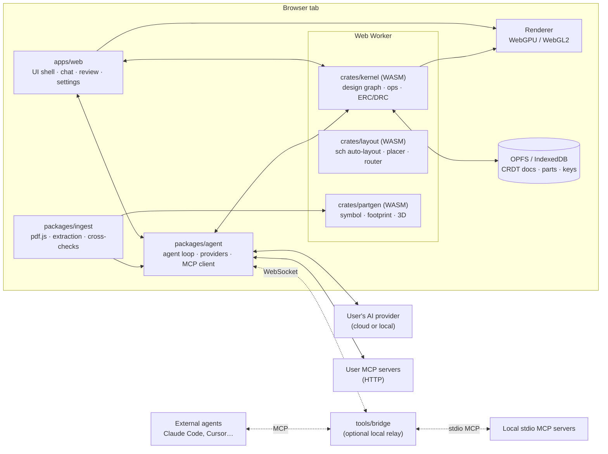
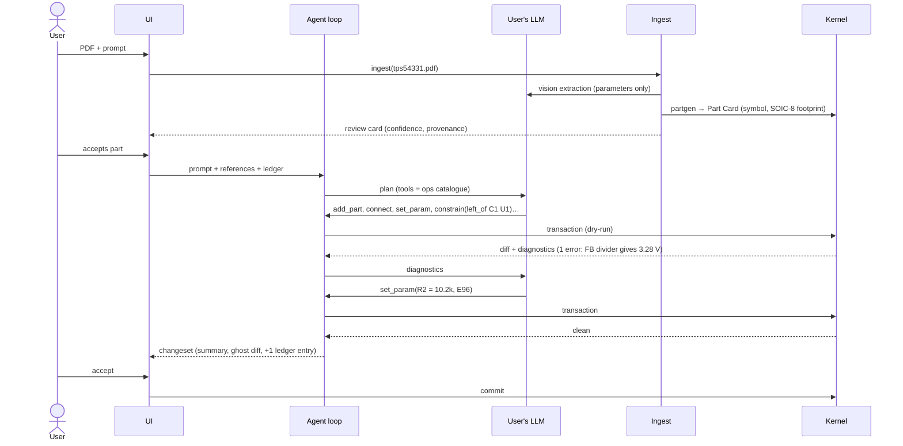

# Architecture

> Status: draft v0.1, 2026-09-25. Working name **Tracewise**.

## 1. Goals and non-goals

**Goals**

1. The AI does **all** design work: schematic capture, part creation, placement, routing, fab output.
2. The human steers by **conversation, hints and review**, not by drawing.
3. **Bring your own AI** (cloud or local) and **bring your own MCP servers** to add capabilities.
4. **Correct by construction.** The AI should not be able to produce a broken design without the system noticing, refusing or flagging it.
5. **Browser only.** Nothing to install for the core product. An optional local relay unlocks extras.
6. Professional scope: multi-sheet hierarchical schematics, 2–16+ layer boards, differential pairs, impedance-controlled nets, fab-ready output.

**Non-goals (for now)**

- KiCad, Altium or Eagle import/export. We use our own native format and export only fab outputs (Gerber X2, Excellon, IPC-D-356 netlist, pick-and-place, BOM, PDF/SVG).
- A hosted AI service. We never proxy or pay for model calls. The user's key talks to the user's provider.
- Manual drawing tools. Direct manipulation exists only as a way to **give hints** (see §3.4).

## 2. The core idea: intent in, geometry out

LLMs are good at **intent** ("decouple each VDD pin with 100 nF placed close to the pin") and bad at
**coordinates** (pad positions, trace segments, clearance maths). So the system is split along that line:

```
  ┌───────────────┐   typed ops (JSON)    ┌──────────────────────────┐
  │  AI agent     │ ────────────────────▶ │  Design kernel (WASM)    │
  │  (user's LLM) │ ◀──────────────────── │  validate · solve · check│
  └───────────────┘  diffs + diagnostics  └──────────────────────────┘
          ▲                                          │
          │ hints, review                            ▼
       Human  ◀──────────── canvas, changesets, diagnostics
```

The AI never sends `(x, y)` for a wire or trace segment. It sends semantic operations:

```jsonc
{ "op": "connect",   "pins": ["U1.VIN", "C1.1", "J1.1"], "net": "+12V" }
{ "op": "constrain", "kind": "near", "a": "C3", "b": "U1.VDD", "max_mm": 2.0 }
{ "op": "route",     "scope": { "net_class": "PWR" }, "strategy": "shortest", "layers": ["F.Cu", "In2.Cu"] }
```

Deterministic solvers in the kernel (schematic auto-layout, placement solver, router) produce the
geometry. The same inputs give the same output, which makes results testable and diffs stable.

The AI *can* give geometric intent when it matters (`place U1 at board center, rotate 90°`), but
always as a **constraint** that the solvers respect, never as raw primitives.

## 3. Principles

### 3.1 One operation catalogue, many front-ends
Every capability is defined **once** as a typed operation in `packages/ops-schema` (JSON Schema plus
docs plus examples). Code generation produces:

- the tool definitions for the in-app agent,
- the MCP server surface (for external agents through the relay),
- a TypeScript/Rust client API for scripting and tests,
- the UI's own actions. When the user accepts a changeset or drags a hint, the UI emits the same ops.

So there is no hidden capability that only a human (or only the AI) can use. See [ops-api.md](design/ops-api.md).

### 3.2 Every op is a transaction
`validate → dry-run → diff → (review) → commit`. An invalid op is **refused with a structured,
actionable reason** instead of being applied and "fixed later":

```json
{ "status": "rejected",
  "code": "CURRENT_CAPACITY",
  "message": "Net +3V3 (net class PWR, 2.0 A) cannot be routed with 0.15 mm on 1 oz copper; minimum 0.64 mm at 10 °C rise.",
  "fix_hints": [{ "op": "set_rule", "net_class": "PWR", "track_width_mm": 0.7 }] }
```

### 3.3 Closed verification loop
After every changeset the kernel runs **incremental checks** and returns machine-readable diagnostics:

| Layer | Examples |
|---|---|
| ERC (electrical) | unconnected inputs, output–output conflicts, power pins without source, missing ground |
| Semantic ERC | missing decoupling per datasheet, capacitor voltage rating < 1.5 × net voltage, polarised part reversed, open-drain without pull-up, I²C address clash, missing ESD on connector |
| Part integrity | symbol pin ↔ footprint pad mapping, pin count, package mismatch |
| DRC (physical) | clearance, width, annular ring, drill, courtyard overlap, silkscreen over pads, board-edge clearance |
| Signal rules | diff-pair skew, length matching, impedance per stack-up, return-path discontinuities |
| Fab profile | the chosen manufacturer's capabilities (e.g. JLCPCB 4-layer standard) |

The agent loop is **not allowed to finish** a task with open errors. It must fix them or create an
explicit **waiver** with a reason, which the user sees and must accept. Errors and warnings are kept
apart. Waivers are part of the design and get reviewed like everything else.

### 3.4 Hints become durable constraints
A user hint is turned into structured constraints, **echoed back for confirmation**, and stored in the
**Constraint Ledger**:

| User says / does | Ledger entry |
|---|---|
| "place V1 to the left of U1" | `left_of(V1, U1)` · placement · soft(0.8) |
| "make C1 100 µF" | `param(C1.capacitance) = 100µF` · hard |
| "keep the switching loop tiny" | `loop_area(U1.SW, L1, C_in, max=25mm²)` · soft |
| drags R5 next to U2 | `near(R5, U2, ≤3mm)` + `side(R5, left_of U2)` |
| lasso-selects 4 caps + "these on the bottom" | `layer(C4,C5,C6,C7) = B` |

Every later re-layout respects the ledger, so a hint doesn't get lost when the AI re-places or
re-routes. Entries can be edited, disabled or deleted, and each one links back to the chat message
it came from.

**The canvas is for pointing and hinting, not drawing.** Click or lasso gives references for chat
("these", "this net"). Dragging creates or updates a placement constraint. Nothing else changes
geometry by hand.

### 3.5 Changesets, branches and autonomy modes
AI work lands as a **changeset**: a group of committed ops with a natural-language summary, a
ghost-overlay diff on the canvas, and a diagnostics delta (`+0 errors, −3 warnings`). Autonomy modes:

- **Autopilot**: changesets commit automatically. The user reviews afterwards.
- **Review** (default): each changeset waits for accept/reject. Hunks can be accepted one by one.
- **Step**: the AI proposes a plan first, and each step needs approval.

The design history is an op log on top of a CRDT document, so undo, branching ("try a 2-layer
variant"), and comparing branches are cheap.

### 3.6 Parts from datasheets, generated deterministically
The LLM reads the datasheet, but **never draws pads**. It extracts *parameters* (pin table, package
code, dimension table), and parametric generators (IPC-7351 land pattern calculator, symbol generator,
3D body generator) build the geometry. Every extracted value keeps **provenance** (PDF page + bounding
box) and a confidence score, and is cross-checked. See [part-ingest.md](design/part-ingest.md).

### 3.7 Bring your own AI, bring your own tools
- Provider adapters: Anthropic, OpenAI-compatible (OpenAI, OpenRouter, Azure, Groq, vLLM…), Google Gemini, Ollama, LM Studio.
- **Model roles**: *planner* (strong reasoning), *vision extractor* (datasheets), *checker* (cheap second opinion), *summarizer*. Each role can use a different model.
- User MCP servers (Streamable HTTP) are attached in settings. Their tools show up to the agent with a namespace (`digikey.search`, `acme_pdm.lookup`) and a trust level.
- **Recipes**: shareable bundles of prompt + constraints + tool allow-list + reference sub-circuit (e.g. "Buck converter, TI TPS5433x family").

Details: [ai-loop.md](design/ai-loop.md).

### 3.8 Local-first
The document is a **CRDT** (Automerge 3 recommended; Yjs as fallback) persisted in **OPFS**. Part
libraries and API keys live in IndexedDB. Keys are encrypted with a non-extractable WebCrypto key.
No server is needed for core use. Export writes a **canonical, deterministic JSON text** form
(`*.twd` bundle) that diffs well in git. The same CRDT later gives us real-time collaboration.

### 3.9 Quality is measured
An **agent eval harness** (`evals/`) runs task scripts against golden designs, for example
"add a USB-C PD sink for 20 V", "fan out this BGA on 6 layers", "import this datasheet". It scores them
on ERC/DRC cleanliness, constraint satisfaction, part-extraction accuracy, op count and token cost.
It runs in CI for kernel changes and against each supported model. We publish a model
compatibility table so users know which BYO models work well.

## 4. Components



| Component | Language | Responsibility |
|---|---|---|
| `crates/kernel` | Rust → WASM | Design graph, op execution and transactions, undo/op log, CRDT binding, ERC/DRC/semantic checks, geometry (polygons, clearance, copper pours), fab output writers |
| `crates/layout` | Rust → WASM | Schematic auto-layout (functional grouping + layered orthogonal routing), placement solver (constraints + force-directed + simulated annealing), router (topological/push-and-shove, diff-pairs, length tuning), pour/plane generation |
| `crates/partgen` | Rust → WASM | Parametric generators: IPC-7351 land patterns for common package families, symbol generator, 3D body (STEP/GLB) generator |
| `packages/ops-schema` | JSON Schema + TS | Single source of truth for ops, results, diagnostics. Codegen for all front-ends |
| `packages/agent` | TS | Provider adapters, agent loop, verification loop, hint parser, MCP client, recipe runtime, token/cost budget |
| `packages/ingest` | TS | pdf.js text/image extraction, page classification, prompts for structured extraction, cross-checks, provenance |
| `apps/web` | TS (SvelteKit or React + Vite) | Workspaces (see [ui.md](design/ui.md)): schematic = chat + canvas + inspector with inline changeset review; layout = full canvas + command bar; parts; settings |
| Renderer | TS + WGSL | Shared scene graph with layers, instanced primitives, SDF text. Schematic and board views. 3D (three.js) later |
| `tools/bridge` | TS (Node/Deno, `npx`) | Local relay: MCP server for external agents, proxy for stdio MCP servers and CORS-blocked providers |
| `evals/` | TS + Rust | Golden designs, task scripts, scoring, model compatibility report |

### Why Rust → WASM for the kernel
DRC, routing and polygon operations are CPU-heavy and must be exactly right. Rust gives predictable
performance, strong typing of geometry (integer nanometre units, no float drift), a mature
computational-geometry ecosystem (`geo`, `i_overlay`, `clipper2` ports, `rstar`), and the same code
runs natively in CI and in the evals. The kernel runs in a **Web Worker**, so the UI never blocks.
Multi-threaded routing uses `wasm-bindgen-rayon` (needs cross-origin isolation, COOP/COEP headers).

## 5. One AI turn, end to end

Scenario: *the user drops `tps54331.pdf` and writes "12 V to 3.3 V, 2 A, put C1 left of U1".*



Each responsibility in this story sits in exactly one component. Ingest owns the PDF, the LLM owns
the decisions, the kernel owns geometry and truth, and the UI owns review.

## 6. Security and privacy

- API keys never leave the browser except toward the provider the user configured. They are encrypted at rest.
- MCP servers have **trust levels**: *read-only* (e.g. stock lookup) runs freely; *mutating* tools need approval per call or per session. Every MCP call is logged in the changeset.
- Datasheet content and MCP tool results are treated as **untrusted data** in prompts (prompt-injection defence: delimited, never followed as instructions, and the agent cannot run mutating ops that a tool result asks for without the plan explaining why).
- The relay binds to `127.0.0.1` only and pairs with the tab using a one-time code. Its MCP server can only reach tabs that were paired.
- Strict CSP. The app is served as static files. Optional COOP/COEP for threads.

## 7. Roadmap

| Milestone | Scope | Exit criteria |
|---|---|---|
| **M0 Kernel + schematic** | Data model, ops catalogue, transactions, CRDT persistence, schematic auto-layout, ERC, in-app agent with 1–2 providers, schematic workspace ([ui.md](design/ui.md)) | Agent builds a 30-part schematic from a prompt, ERC-clean, with ledger hints respected on re-layout |
| **M1 Part ingest** | pdf.js pipeline, partgen for SOIC/SOT/QFN/QFP/DFN/chip/BGA, review UI, library | ≥95 % field accuracy on a 200-datasheet eval set; 0 wrong pin mappings reach the library unflagged |
| **M2 Board + placement** | Board outline, stack-up, fab profiles, placement solver, DRC (placement), 2D board view | Agent places a 4-layer board meeting ledger and courtyard rules |
| **M3 Routing + fab** | Router, pours, diff-pairs, length/impedance, full DRC, Gerber/drill/PnP/BOM | Golden boards route DRC-clean; Gerbers verified in an external viewer and a real fab order |
| **M4 Openness** | Relay, MCP server for external agents, recipes, eval report per model | Claude Code can drive a full design via MCP |
| **M5 Collaboration** | Multi-user sessions over CRDT sync, comments, shared libraries | Two users + two agents editing one project |

### M0 progress (2026-09-25)

Done:
- Op catalogue (zod → JSON Schema tools) with 14 edit ops and 8 query ops, atomic transactions, dry runs, structured rejections with candidates and fix hints
- Checks: ERC (unconnected pins, output conflicts, power not driven, including through series parts), datasheet requirements (bootstrap cap, decoupling, pulls), ratings (capacitor voltage and derating, pin absolute max, polarity), ledger violations, waivers
- Deterministic schematic auto-layout: anchors in rows ordered by constraints and signal flow, satellites on pins with crossing-free column order, series chains, decoupling rows, labels for everything not wired
- Pages are derived, not authored: the layout flows each sheet's blocks (a regulator with its parts, an IC with its satellites, a connector column…) onto A4 landscape pages at 1:1, never splitting a block (a block larger than the paper gets an oversized page that prints scaled). Pages sit in a near-square grid on the canvas (left to right, top to bottom) with a frame and title block (what is on the page, sheet, page n of N), so the sheet still reads as one drawing; ⌘P prints them one per sheet of paper (or to PDF). Pages are named after their main parts; the agent can image one (`get_schematic_image page`). Sheets stay the user's explicit grouping above pages.
- Regulators (power in, power out, ground) drawn in datasheet reference style: input rail left, switch node / inductor / output rail right, shunts (caps, catch diode, feedback divider) to one common ground line, pin-to-rail parts (bootstrap cap) and pin-to-ground networks (soft-start, compensation) ordered so that no wires cross; `arrangement compact` opts out
- Conventional sub-circuit drawings: four-diode full bridges are recognised and drawn as the classic 45° diamond (rotated symbols, diagonal wires); `constrain arrangement inline` opts out; single-package bridge part with a diamond symbol
- Changesets: entity-level hunks, partial accept by merge, undo, canonical JSON export/import
- Agent loop with verification, `calc` tool, `ask_user`, Anthropic provider (browser BYO key), offline scripted demo
- Svelte 5 schematic workspace (A + C), parts browser, settings, IndexedDB persistence with an encrypted key

Deviations (deliberate, to revisit):
- **Kernel in TypeScript** (no Rust toolchain on the dev machine yet). It sits behind the same RPC/API in a Web Worker, so the Rust/WASM kernel can replace it without touching the agent or UI.
- **Plain JSON persistence** in IndexedDB instead of a CRDT in OPFS. The CRDT comes with branching/collaboration.
- **Counter-based ids** (`c_1a`) instead of ULIDs, for deterministic tests and diffs.
- **Autonomy modes**: Auto and Review. Step mode (plan approval) is not built yet.

Pulled forward from M4: the **local bridge** (`tools/bridge`), an MCP server that relays to the open tab, so an external agent on the user's own plan can drive the design through the same op catalogue and review flow.

Open for M0 exit: multi-sheet agent workflows, an eval harness with golden tasks run against real models, and layout quality on 30+ part designs.

### M2/M3 first slice: board, routing, fab (2026-09-26)

The schematic-to-manufacturing path works end to end for small boards:
- **Footprints for every part**: standard packages (chip sizes, SOD/SMA, SOT-23/-5/-6/-223, SOIC, pin headers) plus imported package data (QFP/QFN/DFN/SO*/BGA/DIP) through one generator; the part's `package` parameter selects the size.
- **Board model**: `Design.board` (outline or sized to fit, 2/4 layers, rules), ops `set_board` and `place` (a hard `position` constraint), query `get_board`. Placement and routing are derived, like the schematic.
- **Placer** (`kernel/board.ts`): starts from the schematic grouping, relaxes with net springs (supply/ground weak), one decoupling cap per supply pin, `near` constraints, courtyard separation; best rotation for two-pin parts; pinned parts are fixed and the rest stays in the board frame (and inside a fixed outline).
- **Router** (`kernel/router.ts`): grid maze router (0.1 mm, 45°, vias) with clearance built into per-width maps, MST connection order, reserved fine-pitch escapes, retries with varied order, a time budget; runs in its own web worker. **Planes** (`set_plane`): inner layers are dedicated to one net (no tracks; its pads drop onto the plane with a via), outer layers get a pour around the tracks; automatic default GND on B.Cu, or GND on In1.Cu and the main supply on In2.Cu with 4 layers. Independent copper DRC (`kernel/drc.ts`).
- **Fab outputs** (`packages/fab`): Gerber X2 (copper, mask, paste, silkscreen, outline, pours as regions), Excellon, BOM, pick-and-place, one zip; verified with tracespace's parser/renderer.
- **Layout workspace**: 2D board (pads, tracks, pours, ratsnest, silk), drag to pin, R to rotate, unpin, DRC list, fab download, and a three.js 3D board built from the same package bodies as the Parts view.
- **Manufacturer limits** (2026-10-09, [fab-rules](design/fab-rules.md)): `board.fab` holds a fab profile (JLCPCB, PCBWay, Eurocircuits presets, or limits the agent imported from a capabilities page with their source); rules are raised to the limits, `set_board` refuses values below them, `DRC.FAB_*` checks tracks, vias, holes, rings, hole spacing and board size.

Not yet: bottom-side placement, differential pairs and length/impedance rules, thermal reliefs, non-rectangular outlines, a push-and-shove router for dense boards (the maze router is order-sensitive), and a real fab order as the exit test.

## 8. Main risks

| Risk | Mitigation |
|---|---|
| Datasheet extraction errors (wrong pin → dead board) | Parameters only, two-pass/two-model agreement, provenance, deterministic generators, mandatory human confirm for low-confidence fields, cross-check against distributor data via MCP |
| Router quality vs. commercial tools | Start with topological/push-and-shove for typical 2–6 layer boards; AI supplies routing *strategy* (order, layers, escape patterns) as constraints; manual waivers for hard cases |
| Weak BYO models make bad decisions | Kernel refuses invalid ops; semantic ERC; eval-based model compatibility table; recommend model per role |
| Browser limits (CORS, memory, threads) | Direct-browser APIs where available (Anthropic, OpenAI, Gemini, local servers with CORS on); relay for the rest; WASM64/memory64 when available; chunked geometry |
| Token cost on large designs | Compact, queryable design context (the agent *queries* the design with ops rather than receiving it all), summaries per sheet, prompt caching |
| Scope | Strict milestone gates; the eval harness decides "done" |
