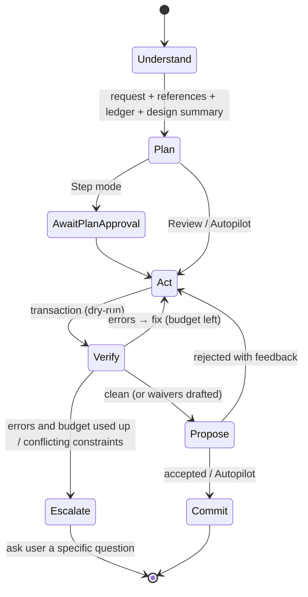

# AI loop, hints, BYO AI and MCP

> Part of the [architecture](../ARCHITECTURE.md). Status: draft.

## 1. Agent loop



- **Understand**: resolve references ("this", lasso selection, "the buck"), parse hints into
  draft ledger entries, and pick a recipe if one matches.
- **Plan**: a short, numbered plan the user can see (and in Step mode must approve), e.g.
  "1. Add U1 + input caps 2. Feedback divider for 3.3 V 3. Inductor per datasheet eq. 12 …".
- **Act**: tool calls against the ops catalogue, always in a transaction with `dry_run: true` first.
- **Verify**: kernel diagnostics go back to the model. There's a **fix budget** (default 5 rounds) so a
  weak model doesn't loop forever. Once no errors are open, drawing warnings (`SCH.*`, not the
  rules the layout follows itself) that the turn brought get one **review round**: the model is
  asked to look at the page, fix what reads badly (with the checks' suggested ops, e.g. `constrain
  arrangement up` for a pull-up drawn hanging) or say why it stays. Warnings that were there
  before the turn are not raised again.
- **Escalate**: instead of guessing, the agent asks one concrete question with options
  ("Inductor saturation current: 3 A part is 6×6 mm; 2.5 A part is 4×4 mm. Which?").
- **Propose → Commit**: a changeset with summary, ghost diff and diagnostics delta.

### Context strategy
The model never gets the whole design by default. It gets:
- a **design summary** (sheets, blocks, part counts, open diagnostics, ledger),
- the **references** the user made (selection → entity IDs + short descriptions),
- query tools to pull detail on demand,
- optionally a **rendered snapshot** of a region for vision-capable models (layout judgement,
  "does this look clean?").

Stable prefix content (system prompt, op schemas, recipe) is ordered so provider prompt caching works.

## 2. Guardrails that make errors unlikely

| Guardrail | Effect |
|---|---|
| Typed ops + kernel validation | Malformed or impossible edits are refused with reasons |
| Hard constraints | Ledger `hard` entries can't be violated. Conflicts are reported, never silently resolved |
| Semantic ERC from Part Cards | Datasheet requirements (decoupling, BOOT caps, pull-ups, abs-max) become checks |
| Engineering calculators as tools | `calc.divider`, `calc.buck_inductor`, `calc.impedance`, `calc.track_current`. The model calls them instead of doing maths in its head. Results are logged in the changeset |
| Checker role | Optional second model reviews a changeset against the request + ledger ("did it do what was asked?") |
| Fix budget + escalation | No endless loops. Uncertainty becomes a question |
| Autonomy modes | Review by default. Autopilot is opt-in per project |
| Deterministic solvers | Geometry is reproducible. The model can't produce a "slightly off" pad |

## 3. Hints → constraints

1. The user writes a hint or does a gesture (drag, lasso + text).
2. The agent (or a cheap *summarizer* model for simple hints) maps it to one or more constraint ops.
   Ambiguous refs are resolved against the selection first, then by name.
3. A **confirmation chip** appears: `left_of(V1, U1) · placement · soft ✓ ✎ ✕`. It's accepted implicitly
   when the changeset is accepted.
4. The entry goes into the ledger with its source message. Later solves respect it. If it becomes
   unsatisfiable, it shows as `violated` with the reason.

Parameter hints ("make C1 100 µF") become `set_param` + a `param` constraint, so a later
"optimise BOM" pass can't quietly change it back.

## 4. Bring your own AI

| Provider | Browser-direct? | Notes |
|---|---|---|
| Anthropic (and Anthropic-compatible gateways) | yes (`anthropic-dangerous-direct-browser-access` header) | Tool use, vision, prompt caching. `AnthropicProvider` |
| OpenAI / Azure OpenAI v1 | yes | `OpenAICompatProvider` (Chat Completions + SSE, plain fetch) |
| Google Gemini | yes | Through its OpenAI-compatible endpoint |
| OpenRouter | yes | Access to many models with one key |
| Ollama / LM Studio / vLLM | yes if CORS is enabled on the local server | Local/offline |
| Anything else OpenAI-compatible | yes if it allows browser requests (CORS) | Company gateways (LiteLLM…). Not yet: through the relay |
| A coding agent's plan (Claude, Copilot, Codex, OpenCode's providers) | through the local server | See §6: the server runs the agent's CLI |

The services and their defaults are in `packages/agent/src/providers/services.ts`.

**Model roles** (configured per project, with defaults per provider):
`planner` · `vision_extractor` · `checker` · `summarizer`. The UI shows expected token cost per
changeset and a monthly budget cap.

Capability detection: on setup, a short self-test (tool call round-trip, JSON-schema adherence,
vision on a sample datasheet page) grades the model and warns if it's unlikely to be reliable
for a role.

## 5. MCP extensibility

- **Remote MCP servers** (Streamable HTTP + OAuth) are added in settings: URL, auth, **trust level**
  (`read-only` / `ask per call` / `trusted`), and a tool allow-list.
- Their tools reach the agent namespaced (`lcsc.search`, `acme.pdm_lookup`, `spice.simulate`).
- Tool results are **untrusted data** in the prompt: wrapped, labelled with their source, and never
  treated as instructions.
- Typical community servers we expect: distributor search/stock/pricing (DigiKey, Mouser, LCSC),
  PLM/PDM lookups, SPICE simulation, thermal estimates, fab quoting.

### Recipes
A recipe is a small package: `recipe.json` (name, match hints, tool allow-list, default
constraints) + `prompt.md` + optional reference sub-circuit (`.twd` fragment). Examples:
"USB-C sink with ESD", "STM32 minimum system", "Buck, TPS5433x family", "RS-485 with isolation".

### Blocks from other projects, implemented
The proven blocks of the user's own earlier projects are the first reference sub-circuits.
`design_query list_blocks { project }` lists the functional blocks of another project in the
projects folder (parts, params, internal and boundary nets; [ops-api](ops-api.md) §7), read-only.
`design_edit import_block { project, block, nets }` copies one in once every boundary net has a target
here; the agent then rechecks the values its result lists against this design's requirements (a
feedback divider set for 5 V, a current limit) with set_param. Shipped recipes come later.

## 6. Local relay (`tools/server`), implemented

```
Claude Code ──MCP stdio──▶ 4k7-server (Node, 127.0.0.1:7777–7781) ──WebSocket──▶ browser tab (kernel + UI)
```

The server also serves the built app on its port, so `npx github:hoihu/4k7` is the whole app: the page comes from
`http://localhost:7777` and talks to the server on its own origin (no website reaching into the computer, which Chrome
gates behind a permission and Safari blocks).

```sh
claude mcp add --scope user 4k7 -- node <repo>/tools/server/src/main.ts
```

- **Access key**: a random UUID (`accessKey`) is created once and kept in `~/.4k7/server.json`. The app's address
  carries it (`http://localhost:7777/<access-key>`, plus `?port=<port>` when another server serves the app); the page is
  served only at that path, and the tab sends the key when it connects. `npx 4k7pcb` opens that link; if the tab is
  not connected, every tool answers with it. The tab remembers the key and reconnects by itself when Claude Code restarts.
- **Security**: loopback only; WebSocket connections from pages other than the app's (localhost on the server ports,
  the configured app address, the dev server in a checkout) are closed before the key is checked, so neither websites
  nor other local pages reach the server; no call is forwarded before the key matches; one connected tab at a time.
- **Tools**: one set for every engine (`agentTools(engine)` in `packages/schema/src/tools.ts`), run by one executor
  in the tab (`App.runTool`): `design_query`, `design_edit`, `calc`, `sourcing`, `import_part`, `pending_import`,
  `artwork`, `read_datasheet`, `get_schematic_image`. Only how a turn starts and ends differs: Claude Code gets
  `get_context` (design state + canvas selection + pending changeset), `propose` (hands the working copy to the user;
  **refused while errors are open**, commits directly in Auto mode) and, from a terminal, `wait_for_review` (blocks until
  the user accepts or rejects); the in-app agent gets the state with each message and asks with `ask_user`.
- **Plan step** (opt-in per project, Settings → General → Plan step; `"planStep": true` in the project file beside the
  conversation, off when absent): from a terminal the agent also gets `propose_plan { steps: string[], summary? }`. The
  app shows the steps, numbered, as a card in the chat, read-only, with Accept / Reject and a comment box. `wait_for_review`
  returns the decision with the comment (`plan accepted. The user's comment: …`), and the plan comes before a pending changeset.
  A decision made before the agent waits is kept for its next `wait_for_review`. A newer plan supersedes a pending one;
  clearing the chat or opening another project leaves it undecided. Auto mode does not accept a plan by itself.
  `get_context` reports `plan_step: on|off`, and the server `instructions` tell the agent to send a plan first when it is on,
  for any task that adds more than about 10 parts. The tool is listed whenever the server runs for a terminal agent, and the
  tab refuses it when the project has the step off ("the plan step is off for this project …"). The tool list is fixed when
  the client connects, and only the tab knows which project is open. Not yet: tracking the steps, editing them, or
  linking a later `propose` to a step. Logic in `apps/web/src/lib/plan.ts`.
- **Prompt**: the design guidance is one text (`DESIGN_GUIDE`, `packages/schema/src/guide.ts`); the in-app system prompt
  and the server `instructions` (the external agent's equivalent of the system prompt) only add their engine's framing.
- The in-app agent and an external agent never edit at the same time: server calls are refused while the in-app agent runs.
- **App chat via a coding agent** (`npm run server`): the tab sends chat messages over the WebSocket with the agent it
  chose (`harness`: `claude-code`, `copilot`, `codex`, `opencode`; `tools/server/src/harness/`); the server runs that CLI headlessly
  with the 4k7 `/mcp` endpoint as its only tool source. Claude Code:
  `claude -p --output-format stream-json --include-partial-messages --tools "" --strict-mcp-config --mcp-config <http>
  --allowedTools mcp__4k7 --permission-mode dontAsk --append-system-prompt <chat rules> [--resume <session>]` in a
  neutral working directory and streams text back. The headless Claude reaches the 4k7 tools through the server's
  `/mcp` (Streamable HTTP) endpoint, which only accepts the bearer token issued to that run and refuses browser origins.
  No `wait_for_review` in chat mode: the user reviews after the turn.
  - **GitHub Copilot CLI**: `copilot -p --output-format json --additional-mcp-config <http> --disable-builtin-mcps
    --available-tools 4k7 --allow-tool 4k7 --no-custom-instructions --session-id=<id>`. It has no system-prompt option, so
    the chat rules open the first message of a conversation. Token totals are per session; a run's are the difference.
  - **Codex CLI**: `codex exec --json --skip-git-repo-check -c … -`, or `codex exec resume … <id> -`, the message on stdin.
    Codex has no list of allowed tools, so `-c` switches off each thing it would add (`FEATURES_OFF` in `harness/codex.ts`, web search,
    sub-agents) and, by name from `codex mcp list --json`, the user's own MCP servers; the rules replace its prompt through
    `model_instructions_file`. The user's login, provider and model stay, and so does `~/.codex/AGENTS.md`, which no setting
    leaves out. Three settings on the 4k7 server make it work at all: `default_tools_approval_mode = "approve"` (headless, Codex
    cancels a call it would ask about), `tool_input_schema_max_bytes` (above 5,000 bytes it strips a schema to nothing, and
    `design_edit`'s is 90,000) and `features.code_mode.direct_only_tool_namespaces` (current models otherwise reach MCP tools only
    from a script). `apply_patch` stays on offer, because only the model catalog decides that, and the read-only sandbox refuses it;
    `exec`/`wait`, on current models, are JavaScript with no files or network; `send_message_to_user_async`, which the catalog gives
    some models (Codex 0.171), only adds a message to the reply. Output comes a message at a time, and its token totals
    are per session like Copilot's. `npm run check:codex` runs the real CLI through the harness against a stand-in for the API and
    fails on any other tool, because a new Codex can add one the harness does not know of. Needs Codex 0.158 or newer: older ones
    strip the schema whatever the setting.
  - **OpenCode**: `opencode run --format json --agent 4k7-chat`, the agent (prompt, `tools: {"*": false, "4k7_*": true}`,
    permissions) and the remote MCP server given in `OPENCODE_CONFIG_CONTENT`, the message on stdin. `opencode run` can
    exit before printing its last step, so the session is read back with `opencode export` afterwards.
  - The welcome message lists every agent and whether it is installed (`harnesses`); OpenCode's model list follows later.
- Not yet: proxying the user's stdio MCP servers and CORS-blocked providers through the relay.
