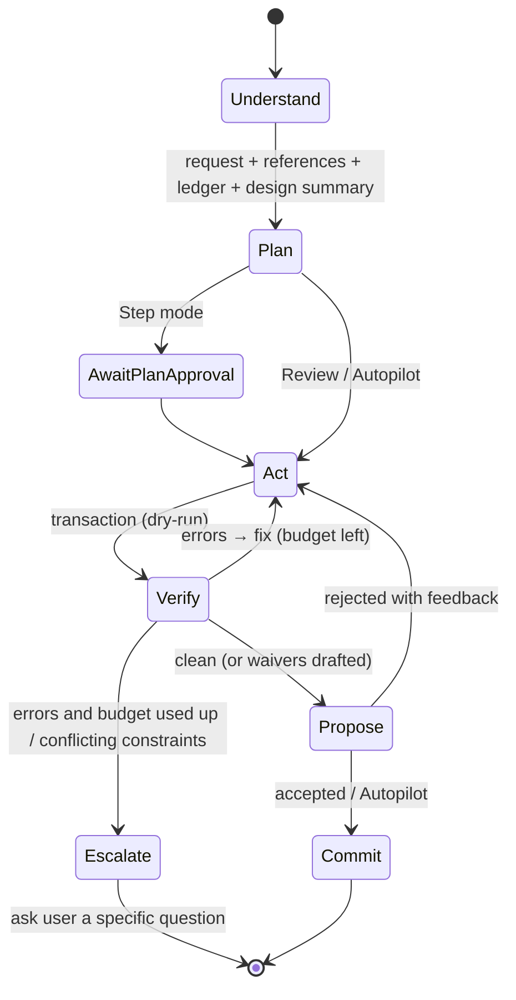

# AI loop, hints, BYO AI and MCP

> Part of the [architecture](../ARCHITECTURE.md). Status: draft.

## 1. Agent loop



- **Understand**: resolve references ("this", lasso selection, "the buck"), parse hints into
  draft ledger entries, and pick a recipe if one matches.
- **Plan**: a short, numbered plan the user can see (and in Step mode must approve), e.g.
  "1. Add U1 + input caps 2. Feedback divider for 3.3 V 3. Inductor per datasheet eq. 12 …".
- **Act**: tool calls against the ops catalogue, always in a transaction with `dry_run: true` first.
- **Verify**: kernel diagnostics go back to the model. There's a **fix budget** (default 5 rounds) so a
  weak model doesn't loop forever.
- **Escalate**: instead of guessing, the agent asks one concrete question with options
  ("Inductor saturation current: 3 A part is 6×6 mm; 2.5 A part is 4×4 mm. Which?").
- **Propose → Commit**: a changeset with summary, ghost diff and diagnostics delta.

### Context strategy
The model never gets the whole design by default. It gets:
- a **design summary** (sheets, blocks, part counts, open diagnostics, ledger),
- the **references** the user made (selection → entity IDs + short descriptions),
- query tools to pull detail on demand,
- optionally a **rendered snapshot** of a region for vision-capable models (layout judgement,
  "does this look clean?").

Stable prefix content (system prompt, op schemas, recipe) is ordered so provider prompt caching works.

## 2. Guardrails that make errors unlikely

| Guardrail | Effect |
|---|---|
| Typed ops + kernel validation | Malformed or impossible edits are refused with reasons |
| Hard constraints | Ledger `hard` entries can't be violated. Conflicts are reported, never silently resolved |
| Semantic ERC from Part Cards | Datasheet requirements (decoupling, BOOT caps, pull-ups, abs-max) become checks |
| Engineering calculators as tools | `calc.divider`, `calc.buck_inductor`, `calc.trace_width`, `calc.impedance`. The model calls them instead of doing maths in its head. Results are logged in the changeset |
| Checker role | Optional second model reviews a changeset against the request + ledger ("did it do what was asked?") |
| Fix budget + escalation | No endless loops. Uncertainty becomes a question |
| Autonomy modes | Review by default. Autopilot is opt-in per project |
| Deterministic solvers | Geometry is reproducible. The model can't produce a "slightly off" pad |

## 3. Hints → constraints

1. The user writes a hint or does a gesture (drag, lasso + text).
2. The agent (or a cheap *summarizer* model for simple hints) maps it to one or more constraint ops.
   Ambiguous refs are resolved against the selection first, then by name.
3. A **confirmation chip** appears: `left_of(V1, U1) · placement · soft ✓ ✎ ✕`. It's accepted implicitly
   when the changeset is accepted.
4. The entry goes into the ledger with its source message. Later solves respect it. If it becomes
   unsatisfiable, it shows as `violated` with the reason.

Parameter hints ("make C1 100 µF") become `set_param` + a `param` constraint, so a later
"optimise BOM" pass can't quietly change it back.

## 4. Bring your own AI

| Provider | Browser-direct? | Notes |
|---|---|---|
| Anthropic | yes (`anthropic-dangerous-direct-browser-access` header) | Tool use, vision, prompt caching |
| OpenAI / Azure OpenAI | yes | Tool use, vision |
| Google Gemini | yes | Tool use, vision, long PDFs |
| OpenRouter | yes | Access to many models with one key |
| Ollama / LM Studio / vLLM | yes if CORS is enabled on the local server, else through the relay | Local/offline |
| Anything else | through the relay | Relay forwards the requests |

**Model roles** (configured per project, with defaults per provider):
`planner` · `vision_extractor` · `checker` · `summarizer`. The UI shows expected token cost per
changeset and a monthly budget cap.

Capability detection: on setup, a short self-test (tool call round-trip, JSON-schema adherence,
vision on a sample datasheet page) grades the model and warns if it's unlikely to be reliable
for a role.

## 5. MCP extensibility

- **Remote MCP servers** (Streamable HTTP + OAuth) are added in settings: URL, auth, **trust level**
  (`read-only` / `ask per call` / `trusted`), and a tool allow-list.
- Their tools reach the agent namespaced (`lcsc.search`, `acme.pdm_lookup`, `spice.simulate`).
- Tool results are **untrusted data** in the prompt: wrapped, labelled with their source, and never
  treated as instructions.
- Typical community servers we expect: distributor search/stock/pricing (DigiKey, Mouser, LCSC),
  PLM/PDM lookups, SPICE simulation, thermal estimates, fab quoting.

### Recipes
A recipe is a small package: `recipe.json` (name, match hints, tool allow-list, default
constraints) + `prompt.md` + optional reference sub-circuit (`.twd` fragment). Examples:
"USB-C sink with ESD", "STM32 minimum system", "Buck, TPS5433x family", "RS-485 with isolation".

## 6. Local relay (`tools/bridge`), implemented

```
Claude Code ──MCP stdio──▶ tracewise-bridge (Node, 127.0.0.1:7777–7781) ──WebSocket──▶ browser tab (kernel + UI)
```

The bridge also serves the built app on its port, so `npx github:hoihu/tracewise` is the whole app: the page comes from
`http://localhost:7777` and talks to the bridge on its own origin (no website reaching into the computer, which Chrome
gates behind a permission and Safari blocks).

```sh
claude mcp add --scope user tracewise -- node <repo>/tools/bridge/src/main.ts
```

- **Access key**: a random UUID (`accessKey`) is created once and kept in `~/.tracewise/bridge.json`. The app's address
  carries it (`http://localhost:7777/<access-key>`, plus `?bridge=<port>` when another bridge serves the app); the page is
  served only at that path, and the tab sends the key when it connects. `npx tracewise` opens that link; if the tab is
  not connected, every tool answers with it. The tab remembers the key and reconnects by itself when Claude Code restarts.
- **Security**: loopback only; WebSocket connections from pages other than the app's (localhost on the bridge ports,
  the configured app address, the dev server in a checkout) are closed before the key is checked, so neither websites
  nor other local pages reach the bridge; no call is forwarded before the key matches; one connected tab at a time.
- **Tools**: one set for every engine (`agentTools(engine)` in `packages/schema/src/tools.ts`), run by one executor
  in the tab (`App.runTool`): `design_query`, `design_edit`, `calc`, `jlc_search`, `import_part`, `pending_import`,
  `artwork`, `read_datasheet`, `get_schematic_image`. Only how a turn starts and ends differs: Claude Code gets
  `get_context` (design state + canvas selection + pending changeset), `propose` (hands the working copy to the user;
  **refused while errors are open**, commits directly in Auto mode) and, from a terminal, `wait_for_review` (blocks until
  the user accepts or rejects); the in-app agent gets the state with each message and asks with `ask_user`.
- **Prompt**: the design guidance is one text (`DESIGN_GUIDE`, `packages/schema/src/guide.ts`); the in-app system prompt
  and the server `instructions` (the external agent's equivalent of the system prompt) only add their engine's framing.
- The in-app agent and an external agent never edit at the same time: bridge calls are refused while the in-app agent runs.
- **App chat via Claude Code** (`npm run bridge`): the tab sends chat messages over the WebSocket; the bridge runs
  `claude -p --output-format stream-json --include-partial-messages --tools "" --strict-mcp-config --mcp-config <http>
  --allowedTools mcp__tracewise --permission-mode dontAsk --append-system-prompt <chat rules> [--resume <session>]` in a
  neutral working directory and streams text back. The headless Claude reaches the Tracewise tools through the bridge's
  `/mcp` (Streamable HTTP) endpoint, which only accepts the bearer token issued to that run and refuses browser origins.
  No `wait_for_review` in chat mode: the user reviews after the turn.
- Not yet: proxying the user's stdio MCP servers and CORS-blocked providers through the relay.
