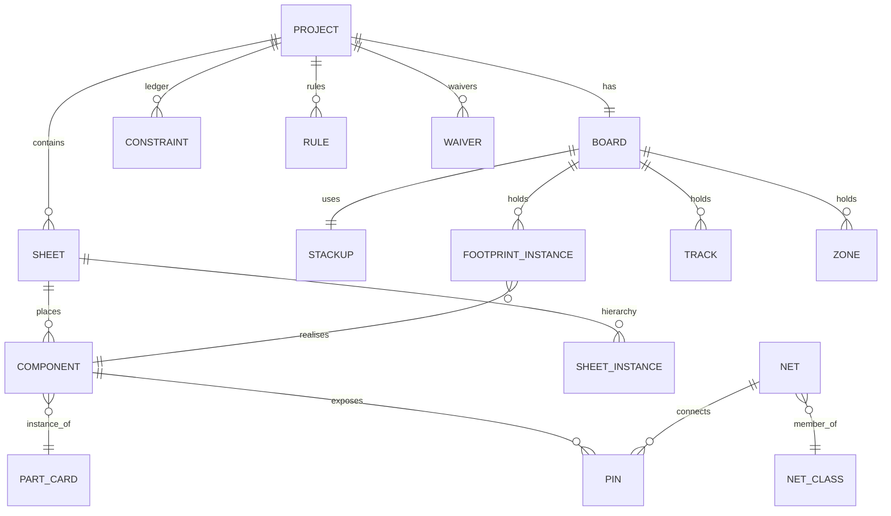

# Data model and native format

> Part of the [architecture](../ARCHITECTURE.md). Status: draft.

## 1. Principles

- **Logical before physical.** The netlist (parts, pins, nets) is the source of truth. Schematic
  graphics and board geometry are *views* derived from it plus constraints. Since 2026-10-13 a
  schematic sheet the agent has arranged keeps its drawing in the design (`Design.drawing`), kept in
  step with the netlist by the kernel ([schematic-drawing](schematic-drawing.md) §2a).
- **Stable IDs everywhere.** Every entity has a ULID. Reference designators (`U1`) are
  attributes, so re-annotation never breaks references in the ledger, chat history or changesets.
- **Integer units.** All geometry is in `i64` nanometres. Angles are in millidegrees. No floats in stored geometry.
- **Derived vs. authored.** Every geometric field is marked `authored` (fixed by a constraint or an
  explicit op) or `derived` (produced by a solver and free to be recomputed). Re-layout only touches
  `derived` fields.

## 2. Entity overview



### Logical layer
| Entity | Key fields |
|---|---|
| `Component` | id, refdes, part_card (hash), params (value, tolerance, voltage, dnp…), sheet, variant flags |
| `Pin` | component, part pin id, electrical type (in/out/bidir/pwr_in/pwr_out/passive/oc/nc), net |
| `Net` | id, name, net_class, attributes (voltage, max_current, loads, frequency, is_diff_pair_of). `NetAttrs.loads` (`set_net loads`): what its pins draw, `{ componentId, pins (numbers on the net), amps }`; a load whose part or pin left the net is ignored, not removed. `NetAttrs.needs` (`set_net needs`): the MCU pin functions the net uses (`["GPIO"]`, `["SCL"]`, `["ADC*"]`), checked by `swap_pins` |
| `PartCard.swapGroups` | pins or gates that may be swapped for each other (`swap_pins`): `{ name, members }`, a member is an ordered tuple of pin numbers (one pin, or a gate such as an op-amp channel `[IN+, IN−, OUT]`), all members of a group the same length, position i matching position i. A pin may be in several groups (a resistor array: each resistor's two ends, and the resistors as gates). Only from the datasheet, never guessed: a wrong group is a dead board. A group of MCU GPIOs carries `functions`: by pin number, what each offers besides plain I/O, from the datasheet's pin-function table (`{ "7": ["SCK", "SCL", "ADC1", …] }`); `swap_pins` then checks each moved net's `NetAttrs.needs` against it (`layout.md` §10). Reset, power and crystal-only pins are never members. Bundled: the LM358's two channels, `generic:R_ARRAY_4` (4 × 0603 convex array: the resistors 1–8, 2–7, 3–6, 4–5 as gates, and each one's two ends), the ATtiny85's PB0–PB4. Not yet: imported MCUs (ingest) |
| `NetClass` | width, clearance, via, impedance target, diff-pair gap, max length |
| `Sheet` | functional block (e.g. "Power 3V3"), ports, child sheet instances |

### Physical layer
| Entity | Key fields |
|---|---|
| `Board` | outline (polygon with arcs), cutouts, mounting holes, keep-outs |
| `Stackup` | layers (copper/dielectric/mask/silk), thickness, εr, copper weight, fab profile |
| `FootprintInstance` | component, position, rotation, side, locked (authored/derived) |
| `Track` / `Via` / `Arc` | net, layer(s), geometry, width |
| `Zone` | net, layer, priority, thermal relief, fill (derived) |

### Constraint ledger
```jsonc
{
  "id": "c_01J9…",
  "kind": "left_of",                 // near, left_of, align, group, layer, param, loop_area, length_match…
  "args": { "a": "cmp_V1", "b": "cmp_U1" },
  "domain": "placement",             // schematic | placement | routing | electrical | param
  "strength": { "type": "soft", "weight": 0.8 },  // or { "type": "hard" }
  "source": { "type": "chat", "message": "msg_…", "text": "place V1 to the left" },
  "status": "active",                // active | disabled | violated
  "created_by": "user"               // user | agent | recipe
}
```

### Rules, diagnostics and waivers
- `Rule`: design rules and fab-profile limits, scoped by net class, layer or area. The first slice keeps them apart: `board.rules` (what the board is routed with, plus `currentRise`: how much copper may heat with its current, which only the current check reads, [layout](layout.md) §14) and `board.fab` (the manufacturer's limits, [fab-rules](fab-rules.md)).
- `BoardView.current` (`CurrentView`): the routed copper against its nets' current, worked out with
  the DRC and never stored; the findings, `get_current_map` and the layout view's heat map read it
  ([layout](layout.md) §14). Per net: `basis` (`split`, `bound`, `unknown`), `status` (`ok`, `over`,
  `unverified`, `unknown`), `amps` (max_current, or GND's from its rails with `fromRails`), and for a
  split `loads` (A reached), `unplaced` (A of max_current no load places), `dropMv` (worst source to
  load), `irDrop` (that load pad, the drop against 3 % of the net's voltage, the pieces that drop
  most on the way: [layout](layout.md) §14), else `why` the loads were not split. Per track and via group: `amps`, `basis`, `status`,
  `split` (its share alone when there is an unplaced rest); tracks `dropMv`, via groups `shared`
  (not the only way across).
- `Diagnostic`: produced, never stored as truth. It has a code, severity, entities and a
  suggested fix. It is shown in the UI and sent to the agent.
- `Waiver`: diagnostic code + entity set + reason + who approved it. Stored and reviewed.

## 3. Storage

| Store | Content |
|---|---|
| OPFS `projects/<id>/doc.automerge` | CRDT document (logical + physical + ledger + rules + waivers) |
| OPFS `projects/<id>/oplog/` | Changesets: ops, summaries, diagnostics delta, agent transcript refs |
| IndexedDB `parts` | Part Cards (content-addressed), provenance, source PDFs (blobs) |
| IndexedDB `settings` | Providers, model roles, MCP servers, encrypted keys |

## 4. Native file format (`.twd`)

A **zip bundle** that is also git-friendly when unpacked (`twd unpack`):

```
project.twd/
  manifest.json          format version, app version, content hashes
  design.json            canonical JSON: sorted keys, stable ID order, one entity per line-group
  ledger.json            constraints
  rules.json             rules, net classes, stack-up, fab profile
  waivers.json
  parts/<hash>.json      embedded Part Cards (the project is self-contained)
  history/               optional op log
```

Canonical JSON: sorted keys, integers only for geometry, `derived` geometry optional (`--no-derived`
exports a minimal file; the kernel re-solves it deterministically). Format versions are migrated
forward by the kernel. Changing the format needs a migration plus a golden-file test.
