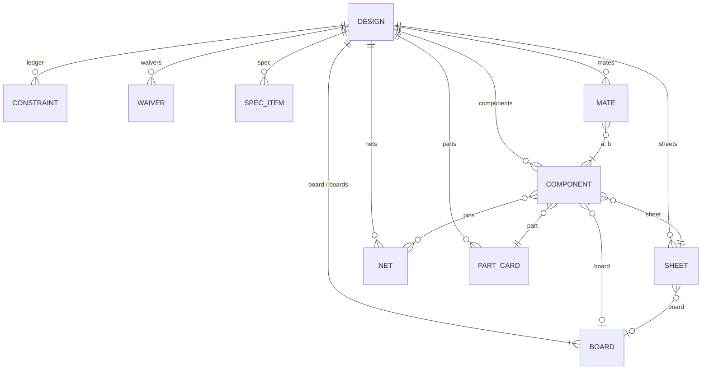

# Data model and native format

> Part of the [architecture](../ARCHITECTURE.md). The types are in `packages/schema/src/model.ts`
> (the design) and `board.ts` (a board's settings); the file is written by `packages/kernel/src/canonical.ts`
> and stored by `tools/server/src/storage.ts`.

## 1. Principles

- **Logical before physical.** The netlist (parts, pins, nets) is the source of truth. Schematic
  graphics and board geometry are views derived from it plus the constraint ledger. Since 2026-10-13 a
  schematic sheet the agent has arranged keeps its drawing in the design (`Design.drawing`), kept in
  step with the netlist by the kernel ([schematic-drawing](schematic-drawing.md) §2a); the board keeps
  its placement and routed copper as a cache (`BoardSettings.placement`, `copper`) and the copper the
  agent drew or locked (`drawn`, `laid`, `locked`).
- **Ids from a counter.** Every entity has an id `<prefix>_<n>` from the design's counter
  (`Design.seq`, base 36; `nextId` in `packages/kernel/src/doc.ts`), so the same ops give the same ids.
  Reference designators (`U1`) are attributes, so re-annotation never breaks the ledger or waivers.
- **Units.** Board geometry is in millimetres, rotations in degrees clockwise; schematic coordinates
  are in mils from the paper's top-left corner. Parameters are kept as entered (`"100nF"`, `"25V"`).

## 2. Entity overview



### Logical
| Entity | Key fields |
|---|---|
| `Component` | id, refdes, part (Part Card id), sheet, params (value, package, voltage … as entered), pins (pin number → net id), noConnect, dnp, board (when not its sheet's) |
| `Net` | id, name, attrs (`NetAttrs`: voltage, external, power, maxCurrent, trackWidth, drawAs, routeFirst, layer, loads, needs). `NetAttrs.loads` (`set_net loads`): what its pins draw, `{ componentId, pins (numbers on the net), amps }`; a load whose part or pin left the net is ignored, not removed. `NetAttrs.needs` (`set_net needs`): the MCU pin functions the net uses (`["GPIO"]`, `["SCL"]`, `["ADC*"]`), checked by `swap_pins` |
| `Sheet` | id, name, order, board (the board its parts are on; absent: the first) |
| `PartCard` | id, mpn, category, refPrefix, package, pins (with electrical types), params, requirements, notes, datasheet, provenance, swap groups; embedded in `Design.parts` so the project is self-contained (`packages/schema/src/part.ts`) |
| `PartCard.swapGroups` | pins or gates that may be swapped for each other (`swap_pins`): `{ name, members }`, a member is an ordered tuple of pin numbers (one pin, or a gate such as an op-amp channel `[IN+, IN−, OUT]`), all members of a group the same length, position i matching position i. A pin may be in several groups (a resistor array: each resistor's two ends, and the resistors as gates). Only from the datasheet, never guessed: a wrong group is a dead board. A group of MCU GPIOs carries `functions`: by pin number, what each offers besides plain I/O, from the datasheet's pin-function table (`{ "7": ["SCK", "SCL", "ADC1", …] }`); `swap_pins` then checks each moved net's `NetAttrs.needs` against it (`layout.md` §10). Reset, power and crystal-only pins are never members. Bundled: the LM358's two channels, `generic:R_ARRAY_4` (4 × 0603 convex array: the resistors 1–8, 2–7, 3–6, 4–5 as gates, and each one's two ends), the ATtiny85's PB0–PB4. Not yet: imported MCUs (ingest) |
| `Description` | what the design does, in words (`describe`): the blocks with their parts, the text of the design document |

### Physical
| Entity | Key fields |
|---|---|
| `BoardSettings` | outline (width/height, `shape`, corner radius, cutouts), layers (2 or 4), rules, fab profile, stack-up, impedance rules, planes, mounting holes, vias, keep-outs, silkscreen graphics, panel; the placement and the routed copper as a cache; the copper the agent drew or locked |
| Several boards | `Design.boards` (`BoardEntry`: id, name, order, settings), format 3. The first board keeps its settings in `Design.board`; a component is on its own `board`, else its sheet's, else the first. `Design.mates` (`Mate`: two connectors `a`, `b`, kind `stack`/`cable`/`edge`/`wire`, optional pin `map`, cable length, stack height) join them: [multi-board](multi-board.md) |
| `EnclosureSettings` | `Design.enclosure`: the brief and the script, one for the whole design ([enclosure](enclosure.md)) |

### Constraint ledger
`Design.ledger`, by id. A `Constraint` has a `kind` (`left_of`, `right_of`, `above`, `below`, `near`,
`param`, `layer`, `arrangement`, `room`, `position`, `sch_position`, `sch_block`, `belongs`, `note`),
the components it names (`a`, `b`), the arguments of its kind (`key`, `value`, `maxMm`, `xMm`/`yMm`/`rot`/`rel`,
`page`/`x`/`y`, …), a `domain` (`schematic`, `placement`, `routing`, `electrical`, `param`), a `strength`
(`hard` or `soft`), and its `source` (`user`, `agent`, `drag` or `recipe`, with the `quote` that produced it):

```jsonc
{
  "id": "k_1a",
  "kind": "left_of",
  "a": "c_4", "b": "c_7",
  "domain": "schematic",
  "strength": "soft",
  "source": { "type": "user", "quote": "place V1 to the left of U1" }
}
```

### Rules, diagnostics and waivers
- Rules: `board.rules` (what the board is routed with, plus `currentRise`: how much copper may heat with its current, which only the current check reads, [layout](layout.md) §14) and `board.fab` (the manufacturer's limits, [fab-rules](fab-rules.md)).
- `BoardView.current` (`CurrentView`): the routed copper against its nets' current, worked out with
  the DRC and never stored; the findings, `get_current_map` and the layout view's heat map read it
  ([layout](layout.md) §14). Per net: `basis` (`split`, `bound`, `unknown`), `status` (`ok`, `over`,
  `unverified`, `unknown`), `amps` (max_current, or GND's from its rails with `fromRails`), and for a
  split `loads` (A reached), `unplaced` (A of max_current no load places), `dropMv` (worst source to
  load), `irDrop` (that load pad, the drop against 3 % of the net's voltage, the pieces that drop
  most on the way: [layout](layout.md) §14), else `why` the loads were not split. Per track and via group: `amps`, `basis`, `status`,
  `split` (its share alone when there is an unplaced rest); tracks `dropMv`, via groups `shared`
  (not the only way across).
- `Diagnostic` (`packages/schema/src/results.ts`): produced, never stored. It has a code, severity,
  message, entities and, where the kernel can tell, the ops that would fix it (`fixHints`). It is shown in the UI and sent to the agent.
- `Waiver`: diagnostic code + entity set + reason + who approved it (`user` or `agent`), and with
  several boards the board whose findings it covers. Stored in `Design.waivers` and reviewed.

### The spec
`Design.spec`, by id (`specify`, `remove_spec`): what the product must do ([spec](spec.md)). Absent when
the design has none (it is never stored empty), so an older design and one without a spec look alike, and
the format number did not change. A `SpecItem` has an `id` (`q_…`), a `text` (one statement that can be true
or false), a `source` (`user` or `agent`, with the user's `quote`; an agent's item is an assumption until the
user confirms it) and its verifiers `verify` (`SpecVerifier`: `part`, `measure`, `check`, `manual`). The
verifiers store nets, boards and parts by id, as the ledger stores components: `net` and `board` are ids, and a
check's `entities` name a part by id (`c_5`, `c_5.EN`) and a net as `net:<id>`. The status of each item
(verified, violated, unverified, waived) is worked out, never stored.

```jsonc
{
  "id": "q_1a",
  "text": "USB-C input",
  "source": { "type": "user", "quote": "power it from USB-C" },
  "verify": [{ "kind": "part", "category": "connector", "pins": ["CC1", "CC2"] }]
}
```

## 3. The file

A project is one file, `<name>.twd.json`, in the projects folder (`~/Documents/4k7` by default;
the file's name is the project's id). It is the `Design` as canonical JSON (`canonicalJson`: sorted
keys, 2-space indent, so the same design gives the same bytes and diffs cleanly in git; the routed
copper cache on one line per board), followed by the plan step when it is on and the conversation
when the user keeps it (`apps/web/src/lib/conversation.ts`). The undo history is not stored.

`Design.format` is 2 for a design of one board and 3 (`MULTI_BOARD_FORMAT`) for a design of several,
so an app that knows only one board refuses it instead of putting every part on one board. Older
formats are refused on load (`migrate` in `canonical.ts`).

Not in the file: imported parts and artwork (one JSON file per record in `~/.4k7/library` and
`~/.4k7/artwork`), datasheets (`~/.4k7/datasheets/<sha256>.pdf`), and the settings and API keys (this
browser's IndexedDB, `apps/web/src/lib/persist.ts`). A design embeds the Part Cards it uses, so it
opens without the library.
