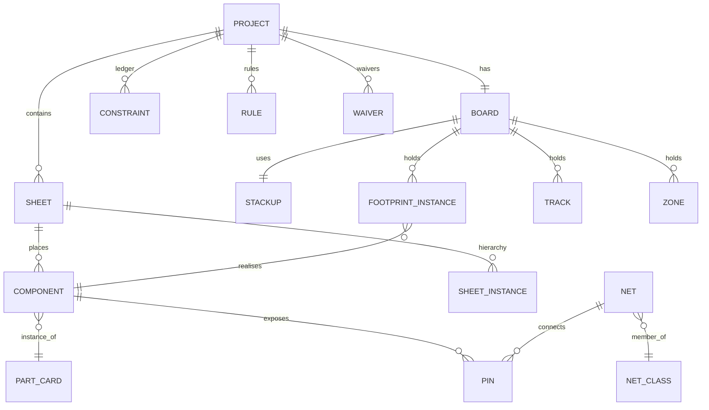

# Data model and native format

> Part of the [architecture](../ARCHITECTURE.md). Status: draft.

## 1. Principles

- **Logical before physical.** The netlist (parts, pins, nets) is the source of truth. Schematic
  graphics and board geometry are *views* derived from it plus constraints.
- **Stable IDs everywhere.** Every entity has a ULID. Reference designators (`U1`) are
  attributes, so re-annotation never breaks references in the ledger, chat history or changesets.
- **Integer units.** All geometry is in `i64` nanometres. Angles are in millidegrees. No floats in stored geometry.
- **Derived vs. authored.** Every geometric field is marked `authored` (fixed by a constraint or an
  explicit op) or `derived` (produced by a solver and free to be recomputed). Re-layout only touches
  `derived` fields.

## 2. Entity overview



### Logical layer
| Entity | Key fields |
|---|---|
| `Component` | id, refdes, part_card (hash), params (value, tolerance, voltage, dnp…), sheet, variant flags |
| `Pin` | component, part pin id, electrical type (in/out/bidir/pwr_in/pwr_out/passive/oc/nc), net |
| `Net` | id, name, net_class, attributes (voltage, max_current, frequency, is_diff_pair_of) |
| `NetClass` | width, clearance, via, impedance target, diff-pair gap, max length |
| `Sheet` | functional block (e.g. "Power 3V3"), ports, child sheet instances |

### Physical layer
| Entity | Key fields |
|---|---|
| `Board` | outline (polygon with arcs), cutouts, mounting holes, keep-outs |
| `Stackup` | layers (copper/dielectric/mask/silk), thickness, εr, copper weight, fab profile |
| `FootprintInstance` | component, position, rotation, side, locked (authored/derived) |
| `Track` / `Via` / `Arc` | net, layer(s), geometry, width |
| `Zone` | net, layer, priority, thermal relief, fill (derived) |

### Constraint ledger
```jsonc
{
  "id": "c_01J9…",
  "kind": "left_of",                 // near, left_of, align, group, layer, param, loop_area, length_match…
  "args": { "a": "cmp_V1", "b": "cmp_U1" },
  "domain": "placement",             // schematic | placement | routing | electrical | param
  "strength": { "type": "soft", "weight": 0.8 },  // or { "type": "hard" }
  "source": { "type": "chat", "message": "msg_…", "text": "place V1 to the left" },
  "status": "active",                // active | disabled | violated
  "created_by": "user"               // user | agent | recipe
}
```

### Rules, diagnostics and waivers
- `Rule`: design rules and fab-profile limits, scoped by net class, layer or area.
- `Diagnostic`: produced, never stored as truth. It has a code, severity, entities and a
  suggested fix. It is shown in the UI and sent to the agent.
- `Waiver`: diagnostic code + entity set + reason + who approved it. Stored and reviewed.

## 3. Storage

| Store | Content |
|---|---|
| OPFS `projects/<id>/doc.automerge` | CRDT document (logical + physical + ledger + rules + waivers) |
| OPFS `projects/<id>/oplog/` | Changesets: ops, summaries, diagnostics delta, agent transcript refs |
| IndexedDB `parts` | Part Cards (content-addressed), provenance, source PDFs (blobs) |
| IndexedDB `settings` | Providers, model roles, MCP servers, encrypted keys |

## 4. Native file format (`.twd`)

A **zip bundle** that is also git-friendly when unpacked (`twd unpack`):

```
project.twd/
  manifest.json          format version, app version, content hashes
  design.json            canonical JSON: sorted keys, stable ID order, one entity per line-group
  ledger.json            constraints
  rules.json             rules, net classes, stack-up, fab profile
  waivers.json
  parts/<hash>.json      embedded Part Cards (the project is self-contained)
  history/               optional op log
```

Today the app writes one file, `.twd.json`: the design as canonical JSON plus a `solved` entry
(one line) with the board as it was solved: parts with their pads, tracks, vias, pour and DRC
result, the solver version, the build and the key of the design it was solved from. On opening,
a `solved` entry whose key matches the design is shown as it is, whatever the current placer and
router would compute; the board is solved afresh only when the design changes (and a proposal
that is rejected, or an undo back to the opened design, brings the stored board back). When the design
does change, the copper of the boards solved before stays wherever the router would get exactly
the same input (pads, nets, widths, rules, planes, outline: the board's `routeKey`), so a new
value, a lock or a silkscreen change keeps the tracks. **Pin layout** (Layout view) uses that: it
locks every part where it is and sets the board size, after which neither a later placer nor a
later router changes the board until the user changes what the copper depends on. The
browser keeps the same record next to the project (`projects/current.solved`). The key is a hash
of the canonical JSON, so `canonicalJson` and `designKey` are part of the format; a file written
by solver 1 is kept as a golden file (`packages/kernel/test/golden`), and the test asks for a
higher `SOLVER_VERSION` whenever the solver's output for it changes.

Canonical JSON: sorted keys, integers only for geometry, `derived` geometry optional (`--no-derived`
exports a minimal file; the kernel re-solves it deterministically). Format versions are migrated
forward by the kernel. Changing the format needs a migration plus a golden-file test.
