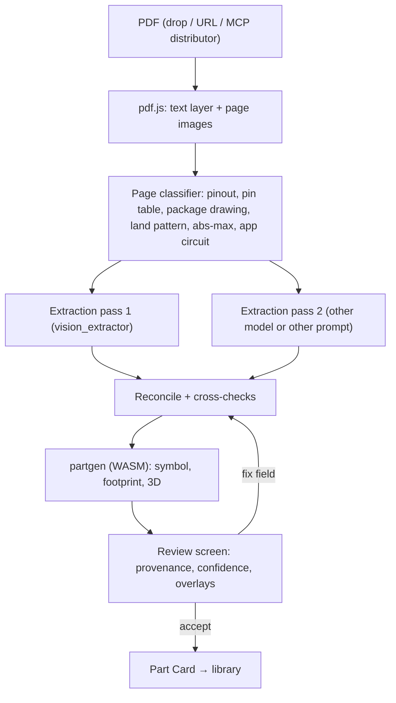

# Part ingest: from datasheet PDF to a verified part

> Part of the [architecture](../ARCHITECTURE.md). Status: draft.

The most dangerous failure in an AI-driven EDA tool is a **silently wrong part**: a swapped pin or a
footprint off by 0.2 mm ruins a board. So the pipeline follows one rule: **the LLM extracts
parameters, deterministic code makes geometry, and every value can be traced back to the PDF.**

## 0. What is implemented

Parts → **Import from datasheet…**: part number plus a PDF (dropped) or a link. The import runs on
a coding agent on the user's computer through the server, like the app chat: Claude Code, GitHub
Copilot CLI or OpenCode (`tools/server/src/harness/*.ts`, `ingest()`). The form picks the chat's
agent when it can import, else Claude Code, else the first one the server found.

1. **Server** (`tools/server/src/chat.ts`, `pdf.ts`): downloads or receives the PDF and makes a
   fresh folder `~/.4k7/ingest/<job>/` with `datasheet.pdf`, `pages/page-NNN.txt` (text,
   table cells separated by ` | `) and `index.txt` (page → first heading). Then it starts the
   agent in that folder with its read-only file tools and an MCP token whose server exposes a
   single tool, `submit_part`; no shell, no web access, no design tools:
   - Claude Code: `claude -p --tools Read,Grep,Glob --permission-mode dontAsk` (reads outside the
     folder are denied, verified);
   - Copilot CLI: `copilot -p --available-tools view grep glob 4k7 --disallow-temp-dir` (it checks
     every path against its working directory); the rules open the message, as it has no
     system-prompt option;
   - OpenCode: `opencode run --agent 4k7-ingest`, the agent given in `OPENCODE_CONFIG_CONTENT` with
     only `read`, `grep`, `glob` and the 4k7 tools, and `external_directory: deny`.
   Progress (pages read, pins written while `submit_part` streams in) reads the same in the app for
   all three, as far as each CLI reports it (OpenCode reports tool calls only once done). The
   folder is deleted when the job ends. A downloaded PDF is also sent to the tab (`datasheet` event).
2. **The agent** decodes the ordering code (e.g. `STM32F777VIT6` → LQFP100), finds the pin table
   column for that package and the package drawing, and submits a `PartDraft`
   (`packages/schema/src/ingest.ts`): pins with number, name, type, alternate functions and the
   **page of each pin's table row**, plus package family, nominal dimensions and drawing page,
   decoupling notes and absolute-maximum supply.
3. **The tab checks every submission** with `draftToCard` (`packages/parts/src/ingest.ts`):
   schema, duplicate numbers, pin count against the package (exposed pad excluded), numbering 1…N
   for leaded packages, valid JEDEC ball names for BGA, supply/ground presence, pages present, and
   a package family that contradicts the package's name (a TSSOP read as QFP would get pads on four
   sides), and whether a footprint can be generated with a pad for every pin. Errors go back to the
   agent as the tool result ("Missing pin numbers: 37–38"), and it resubmits.
4. **Second pass (optional, on by default)**: the server starts a second, fresh session of the agent
   (no memory of the first) with an extra instruction to work in a different order (count groups
   first, read the table backwards, re-derive dimensions). `compareDrafts` compares both accepted
   drafts pin by pin (name, type) and on every footprint-relevant package dimension (of `span_mm`
   only what the footprint uses: both values for QFP, the row distance for two-row packages); the review
   lists each disagreement with both values and the user picks (`mergeDrafts`).
5. **Generators** (`symbolgen.ts`, `footprint.ts`, `body3d.ts`):
   - symbols for big ICs (`planSymbolLayout`): supplies at the top of the left side (stacked by
     name) so the body is only as wide as the pin names, then system pins; grounds stacked along
     the bottom; GPIO ports grouped and balanced between left and right;
   - optional **split into units** (`planUnits`): unit A power + system pins, then two ports per
     unit. Each unit is its own symbol in the schematic (U1A, U1B …); satellites attach to the unit
     that has the pin, decoupling goes under the power unit. Default for parts with > 100 pins,
     switchable in review and for saved parts;
   - footprints for QFP/QFN, SOIC/SSOP/TSSOP/MSOP/DFN, BGA/CSP and DIP (IPC-7351-style nominal);
   - **3D bodies** (boxes and balls: body, gull-wing leads, no-lead terminals, BGA balls, DIP pins,
     pin-1 mark), shown with three.js (`apps/web/src/lib/three-body.ts`, loaded on demand), the same
     renderer and data the board's 3D view will use. Export (STEP/GLB) comes with the board work.
6. **Review**: symbol (single or units), footprint/3D and the pin table, next to the check results
   and the cross-check. With the datasheet open, clicking a pin shows its page with the row
   highlighted, and "drawing p. N" shows the package drawing. **Add to library** stores the card in
   IndexedDB (`library` store) and the PDF by SHA-256 (`datasheets` store, referenced from
   `provenance.document`), and registers the card with the kernel so the agent can place it.
   Designs embed the cards they use.

Not yet: per-field bounding boxes (the row is found again by searching the page text), the
footprint overlay on the datasheet's land-pattern drawing, and STEP/GLB export.

## 1. Pipeline



1. **Acquire.** Drag-drop, URL, or an MCP distributor tool (`digikey.datasheet(MPN)`).
2. **Pre-process.** pdf.js renders pages and extracts the text layer with positions. Table
   detection runs on the text layer first, and the image is used only when needed (scanned PDFs).
3. **Classify pages** so only relevant pages go to the model (saves tokens, reduces confusion).
4. **Extract parameters** as strict JSON (schema below), **twice**: two models, or one model
   with two prompts (table-first vs. drawing-first). Each value comes with page + bbox.
5. **Reconcile.** Values that agree get high confidence. Disagreements are flagged for the user.
6. **Generate** symbol, footprint and 3D body with `crates/partgen`.
7. **Review.** Human confirms (required for any field with confidence below the threshold, and always for pin mapping on first use).
8. **Store** as a content-addressed Part Card.

## 2. Extraction schema (excerpt)

```jsonc
{
  "mpn": "TPS54331DR",
  "manufacturer": "Texas Instruments",
  "variants": [{ "mpn": "TPS54331DR", "package": "SOIC-8", "ordering_suffix": "DR" }],
  "pins": [
    { "number": "1", "name": "BOOT", "type": "passive", "function": "bootstrap",
      "src": { "page": 3, "bbox": [72, 410, 540, 424] } },
    { "number": "2", "name": "VIN",  "type": "pwr_in", "src": { "page": 3, "bbox": [72, 426, 540, 440] } }
  ],
  "package": {
    "family": "SOIC", "pins": 8, "pitch_mm": 1.27,
    "body": { "L": [4.8, 4.9, 5.0], "W": [3.8, 3.9, 4.0] },        // [min, nom, max]
    "lead_span": [5.8, 6.0, 6.2], "lead_width": [0.31, 0.41, 0.51], "lead_length": [0.4, 0.635, 1.27],
    "exposed_pad": null,
    "src": { "page": 27, "bbox": [60, 90, 560, 520] }
  },
  "ratings": { "vin_max_v": 28, "iout_max_a": 3.0 },
  "requirements": [
    { "kind": "cap_between", "pins": ["BOOT", "PH"], "value": "100nF", "src": { "page": 13 } },
    { "kind": "decouple", "pin": "VIN", "value": ">=10uF", "src": { "page": 14 } }
  ]
}
```

The `requirements` list is what makes **semantic ERC** possible (a missing BOOT capacitor becomes a
diagnostic that points to the datasheet page).

## 3. Cross-checks

| Check | Example failure caught |
|---|---|
| Pin count = package pin count (+ EP) | a table row got dropped |
| Pin numbers unique and contiguous | two pins read as "5" |
| Pin names vs. pinout diagram | table and drawing disagree |
| Package code ↔ dimensions ↔ family template | "SOIC-8" with 0.65 mm pitch |
| Dimension sanity: min ≤ nom ≤ max, body < lead span | mm/inch confusion |
| Two-pass agreement | one pass hallucinated a pin function |
| Distributor data via MCP (optional) | package or pin count mismatch with DigiKey/LCSC |
| Known-good library match | same MPN already verified by the user or community |

## 4. Generators (`crates/partgen`)

- **Footprints**: IPC-7351B calculator (toe/heel/side fillets, density level A/B/C, courtyard,
  rounding) for chip, MELF, SOD, SOT, SOIC, SSOP/TSSOP, QFN/DFN (with EP and thermal vias), QFP,
  BGA (pitch, balls, depopulation map), through-hole (DIP, headers, radial/axial), and connector
  templates driven by a dimensioned-drawing description.
- Parts that don't fit a family (odd connectors, modules) use a **constrained drawing DSL**: pads
  described relative to datums taken from the PDF drawing. The LLM fills in the DSL values, the
  generator checks the DSL, and the review overlay is required.
- **Symbols**: pins grouped by function (power top, ground bottom, inputs left, outputs right,
  buses grouped), sized to a grid, with hidden-pin rules forbidden by default. Multi-unit symbols for
  big ICs are split by function block.
- **3D**: extruded body + leads from the same parameters (GLB for display, STEP for export).

## 5. Review screen

- Left: the datasheet page with extracted regions highlighted. Clicking a field scrolls to its source.
- Right: generated symbol and footprint. The footprint can be **overlaid on the datasheet land-pattern
  drawing** at scale to check it visually.
- Per-field confidence with low-confidence fields first. Fields where the passes disagree show both values to pick from.
- "Accept", "Fix and regenerate", "Ask AI about this field".

## 6. Part Card

```
part-card/
  card.json        mpn, manufacturer, parameters, pins, requirements, variants
  symbol.json      generated (+ generator version and inputs)
  footprint.json   generated (+ IPC density level, generator version and inputs)
  body.glb / body.step
  provenance.json  field → (pdf hash, page, bbox, pass agreement, reviewer, timestamp)
  source.pdf       optional (license permitting)
```

The card's hash covers the generator inputs **and** the generator version, so regenerating with a
fixed generator creates a new, traceable version. Projects embed the cards they use.
